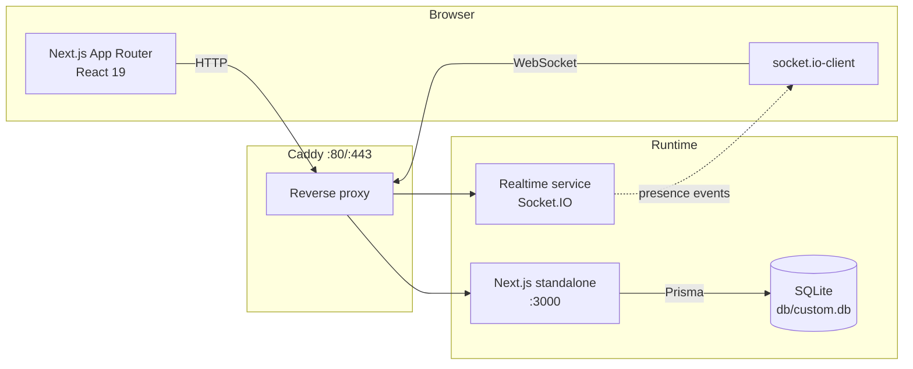

# Voyager One

Notepad kolaboratif real-time dengan identitas tamu tanpa kata sandi.

[](https://github.com/USER/voyager-one/actions/workflows/ci.yml)
[](LICENSE)
[](https://nextjs.org)
[](https://react.dev)

Ruang catatan bersama untuk tim kecil. Tidak ada pendaftaran: pilih nama, warna,
dan emoji, lalu langsung menyunting catatan yang sama secara serempak — lengkap
dengan caret dan kursor jarak jauh.

> Status: `v0.2.1` — berjalan lokal dan di container. Belum ada deployment publik.


## Fitur

| Fitur | Keterangan |
|---|---|
| Editor tiga mode | Text, Markdown, Code dengan syntax highlighting |
| Presence real-time | Daftar kolaborator aktif, caret & kursor berlabel |
| Catatan terkunci | Enkripsi sisi klien (`salt` + `encIv` + `encCt`) |
| Lampiran | Disimpan sebagai `filesJson` (`{name, type, dataUrl}`) |
| Tema | Sky, Paper, Board, Shenzhen |
| Command palette | `cmdk`, navigasi tanpa mouse |
| Activity feed | 7 tipe event: join, leave, create, save, delete, pin, open |

## Stack

| Lapisan | Teknologi |
|---|---|
| Framework | Next.js 16.1.1 (App Router), React 19, TypeScript 5 |
| Styling | Tailwind CSS v4, Radix UI / shadcn-ui |
| Data | Prisma 6.11 + SQLite (`db/custom.db`) |
| Realtime | Socket.IO (`mini-services/realtime`) |
| State & form | Zustand 5, React Hook Form, Zod 4 |
| Runtime | Bun (standalone output), Caddy sebagai reverse proxy |

## Arsitektur



Detail alur request, event realtime, dan skema data ada di
[docs/architecture.md](docs/architecture.md).

## Menjalankan lokal

```bash
git clone https://github.com/USER/voyager-one.git
cd voyager-one

cp .env.example .env          # DATABASE_URL=file:./db/custom.db
bun install

bunx prisma generate
bunx prisma db push           # buat skema di SQLite
bun run db:seed               # opsional: data contoh

bun run dev                   # Next.js di :3000
bun run realtime              # terminal terpisah: Socket.IO
```

Uji kolaborasi: buka `http://localhost:3000` di dua jendela browser berbeda,
masuk dengan nama berbeda, lalu ketik di catatan yang sama.

## Struktur direktori

```
src/app/                 route App Router + 5 API handler
src/components/          komponen inti (editor, panel, presence, caret)
src/components/ui/       primitif UI
src/lib/                 socket client, util, hook
mini-services/realtime/  layanan Socket.IO terpisah
prisma/                  schema + seed
docs/                    arsitektur, model data, ADR
```

## Model data

Dua tabel. `Author` menyimpan identitas tamu, `Note` menyimpan isi dan status.

```prisma
model Author {
  id        String   @id @default(cuid())
  name      String
  color     String
  emoji     String
  notes     Note[]
  createdAt DateTime @default(now())
}

model Note {
  id        String   @id @default(cuid())
  title     String
  body      String   @default("")
  mode      String   @default("text")
  pinned    Boolean  @default(false)
  locked    Boolean  @default(false)
  salt      String?
  encIv     String?
  encCt     String?
  filesJson String   @default("[]")
  version   Int      @default(1)
  authorId  String
  author    Author   @relation(fields: [authorId], references: [id])
  updatedAt DateTime @updatedAt

  @@index([updatedAt])
  @@index([pinned])
}
```

## Kontribusi

Lihat [CONTRIBUTING.md](CONTRIBUTING.md). Untuk laporan keamanan, ikuti
[SECURITY.md](SECURITY.md) — jangan buka issue publik.

## Lisensi

MIT — lihat [LICENSE](LICENSE).
